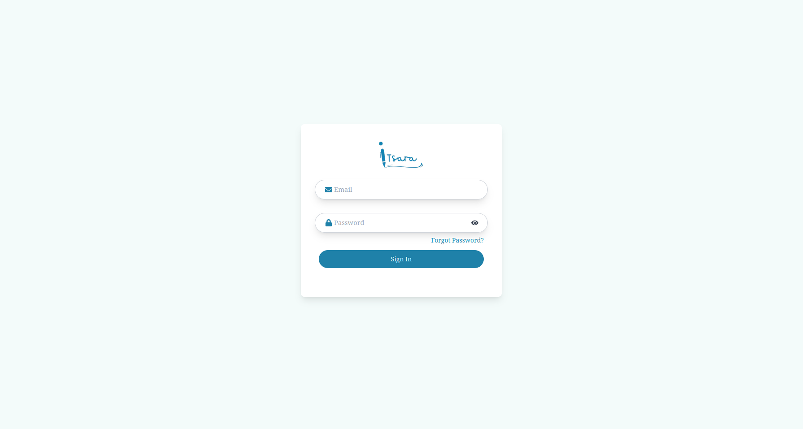
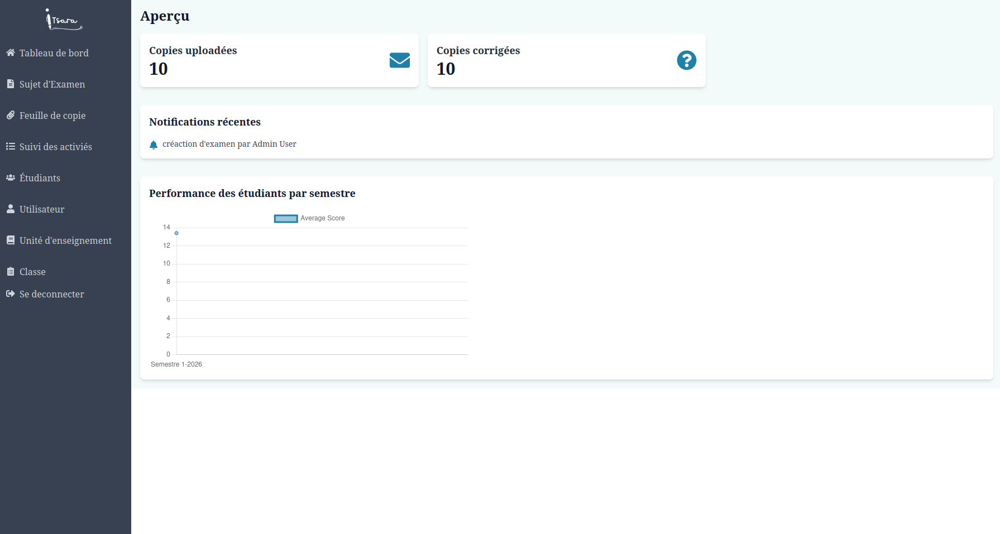
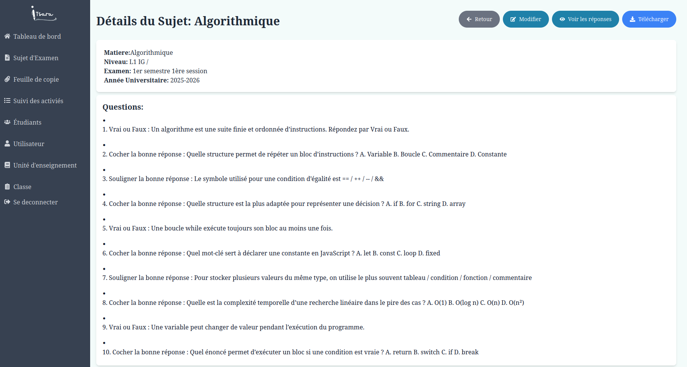
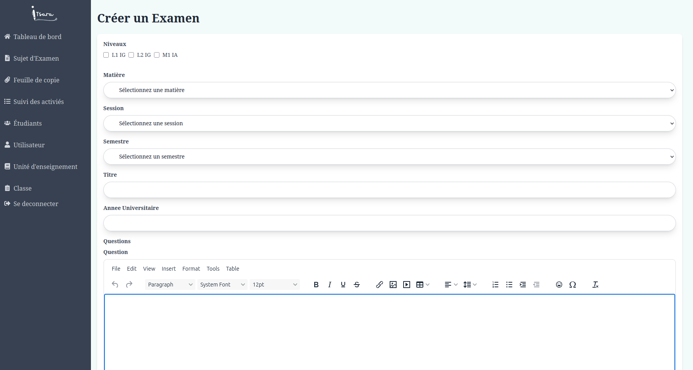
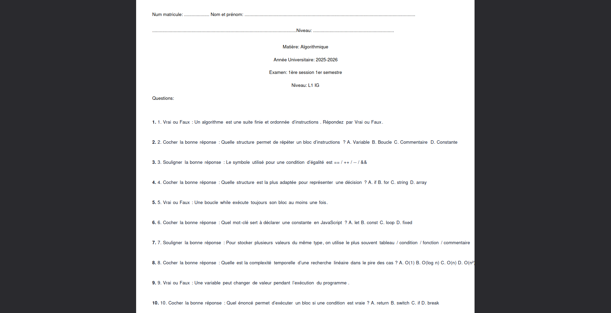
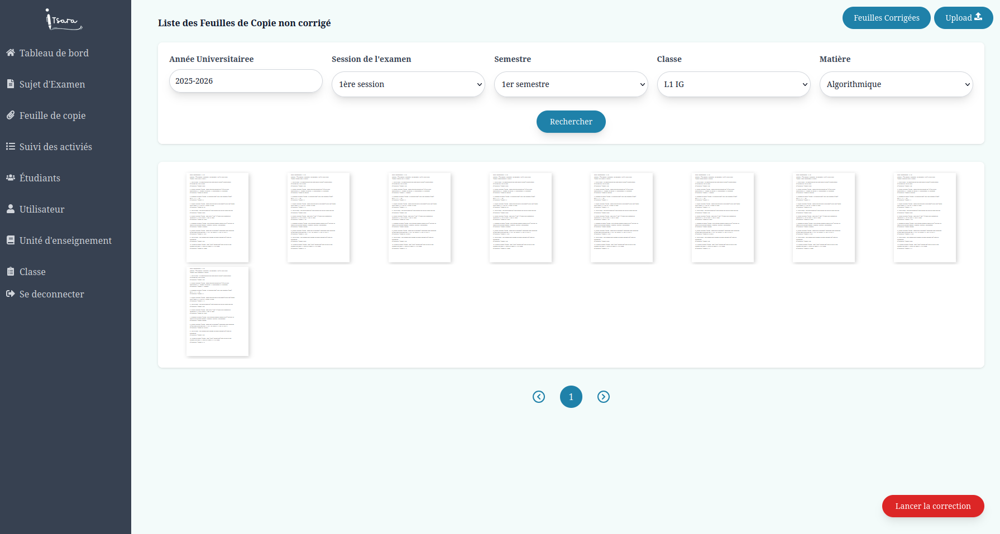

# E-Tsara

E-Tsara est une plateforme de gestion et de correction automatique de copies d'examen.

## Technologies

- Frontend : React
- Backend : Node.js / Express
- Service PDF : Flask
- Base de données : MongoDB
- Exécution locale : Docker Compose

## Structure du projet

- `autograder-frontend/` : interface utilisateur
- `autograder-backend/` : API principale
- `evalPDFService/` : analyse PDF et correction
- `docker-compose.yml` : orchestration locale des services

## Lancement en local

Depuis la racine du projet :

```bash
cd e-tsara
docker compose up --build
```

Services disponibles :

- Frontend : `http://localhost:3000`
- Backend : `http://localhost:8000`
- Service Flask : `http://localhost:5000`
- MongoDB : `mongodb://localhost:27017/autograderDB`

Commandes utiles :

```bash
docker compose up --build -d
docker compose logs -f
docker compose down
```

Remarques :

- utiliser `--build` après une modification du code
- éviter `docker compose down -v` si vous voulez conserver les données MongoDB

## Comptes de test

- Admin : `admin@gmail.com` / `admin@1234`
- Enseignant : `enseignant.ig@gmail.com` / `prof@1234`
- Enseignant : `enseignant.bd@gmail.com` / `prof@1234`
- Personnel : `personnel.scolarite@gmail.com` / `personnel@1234`

## Services utilisés

- `frontend`
  Application React accessible sur `http://localhost:3000`
- `backend`
  API Node.js et Express accessible sur `http://localhost:8000`
- `flask`
  Service Python pour l'analyse PDF et la correction accessible sur `http://localhost:5000`
- `mongo`
  Base de données MongoDB utilisée par le backend
- `seed`
  Service d'initialisation des données de test

## Variables d'environnement

### Backend

Fichier : `autograder-backend/.env`

```env
PORT=8000
MONGO_URI=mongodb://127.0.0.1:27017/autograderDB
SECRET_KEY=change-me
AWS_ACCESS_KEY_ID=your-access-key
AWS_SECRET_ACCESS_KEY=your-secret-key
AWS_REGION=us-east-1
S3_BUCKET_NAME=your-bucket-name
```

Variables principales :

- `PORT` : port du backend
- `MONGO_URI` : connexion à MongoDB
- `SECRET_KEY` : signature des tokens JWT
- `AWS_ACCESS_KEY_ID` : accès AWS
- `AWS_SECRET_ACCESS_KEY` : secret AWS
- `AWS_REGION` : région AWS
- `S3_BUCKET_NAME` : bucket S3 pour les fichiers

### Service Flask

Fichier : `evalPDFService/.env`

```env
OPENAI_API_KEY=your-openai-key
OPENAI_MODEL=gpt-5-nano
OPENAI_TIMEOUT_SECONDS=20
OPENAI_GRADING_ENABLED=true
LOCAL_CORRECT_THRESHOLD=0.72
QUESTION_MATCH_THRESHOLD=0.45
```

Variables principales :

- `OPENAI_API_KEY` : clé API OpenAI
- `OPENAI_MODEL` : modèle utilisé pour la correction
- `OPENAI_TIMEOUT_SECONDS` : délai maximal d'appel OpenAI
- `OPENAI_GRADING_ENABLED` : active ou non la correction OpenAI
- `LOCAL_CORRECT_THRESHOLD` : seuil de validation locale
- `QUESTION_MATCH_THRESHOLD` : seuil de rapprochement des questions

## Fonctionnalités principales

- authentification par rôle
- gestion des sujets d'examen
- création de questions QCM
- gestion et consultation des feuilles de copie
- correction automatique via le service Flask

## Captures

### Connexion



### Tableau de bord



### Liste des sujets



### Création d'un examen



### Sujet d'examen



### Liste des feuilles de copie


